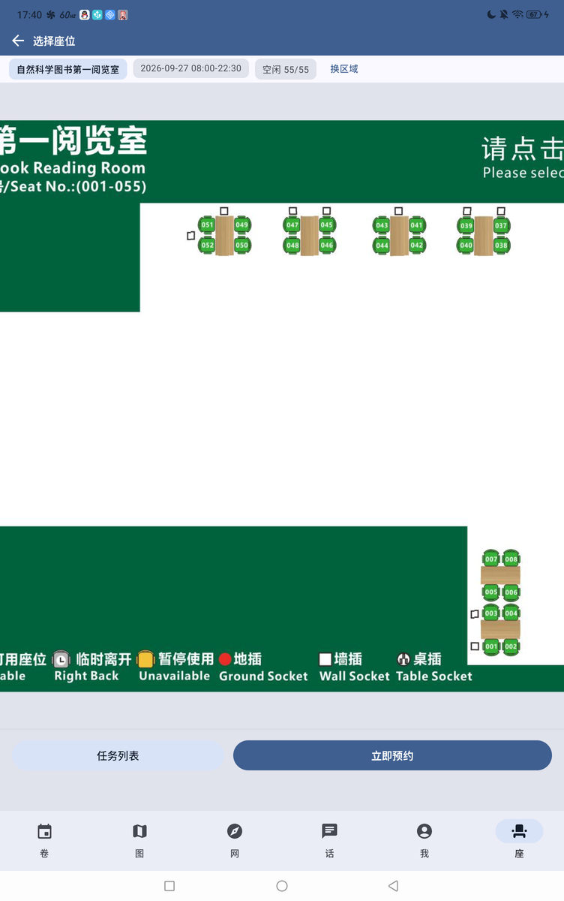
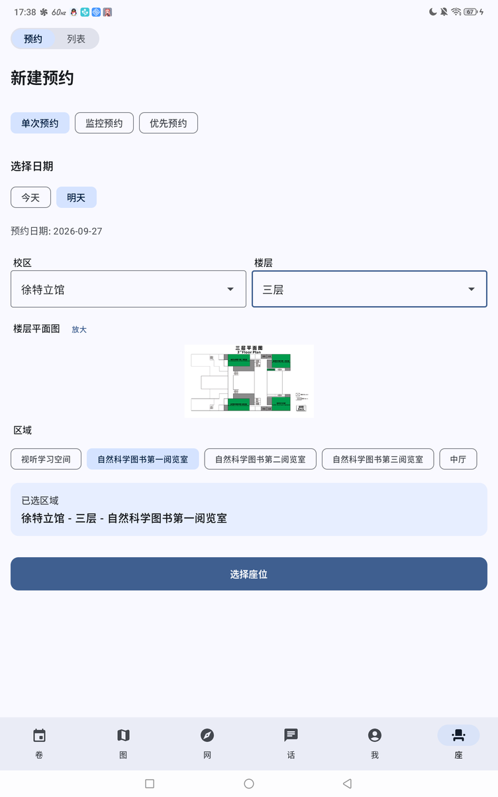
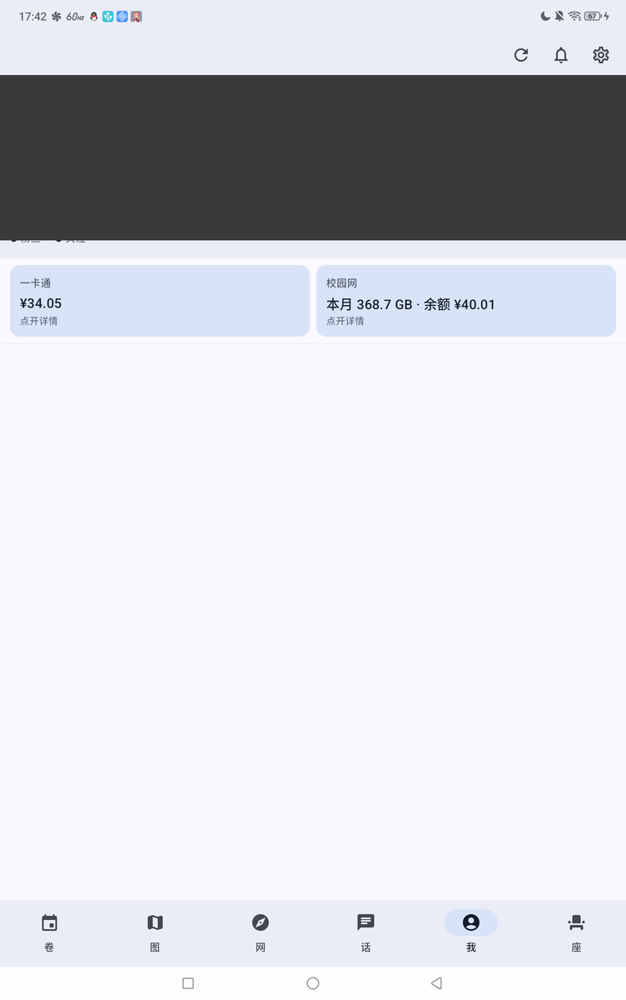
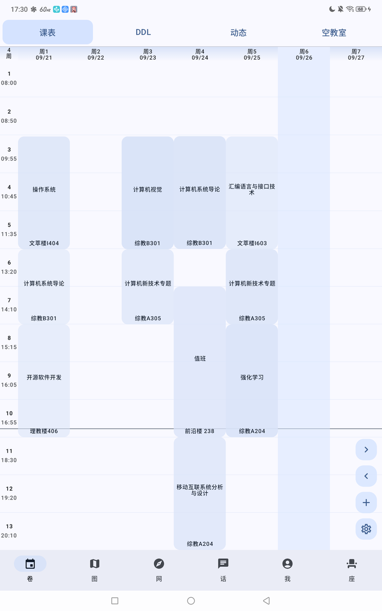
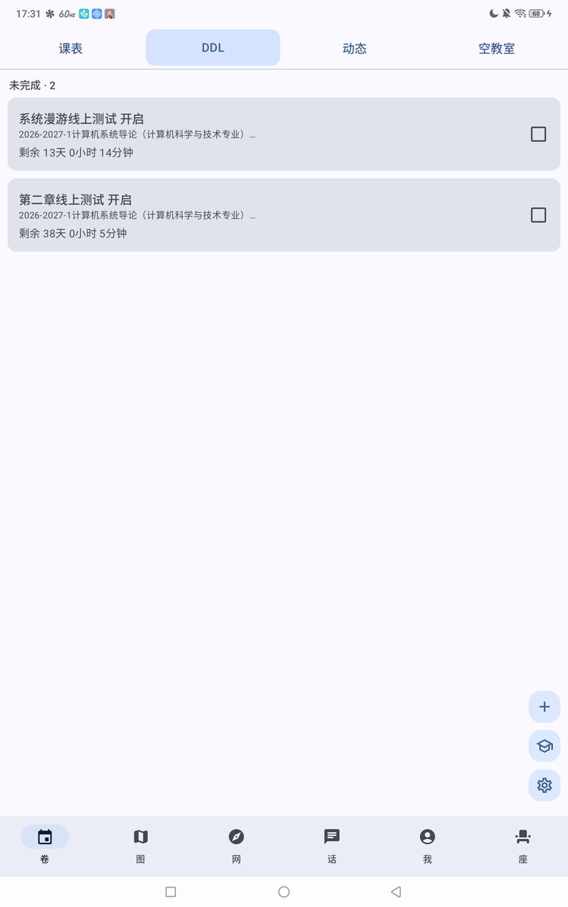
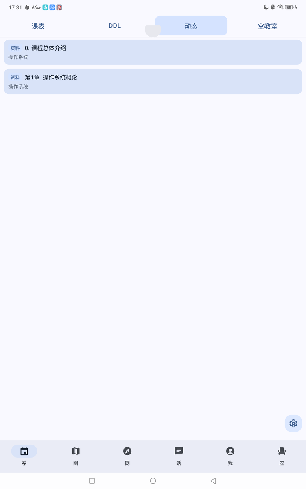
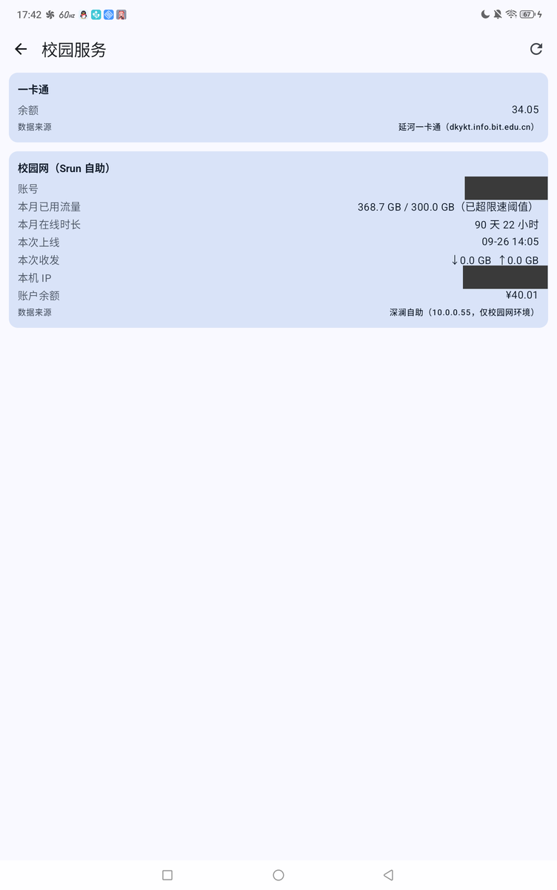
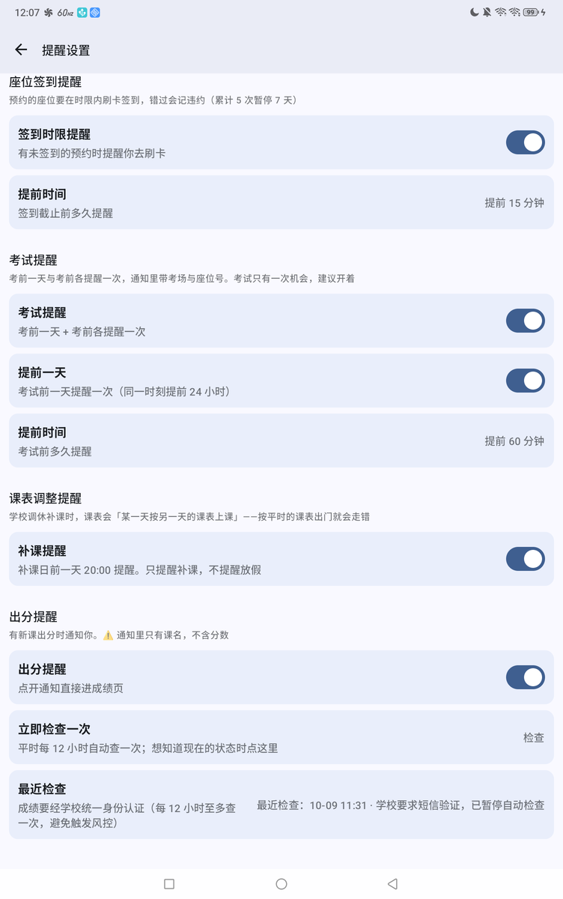

# BIT101-S

> 在 [BIT101-Android](https://github.com/BIT101-dev/BIT101-Android) 之上扩展的北理工校园助手：
> 多了**座位预约**、**桌面小组件**、**提醒中心**、**NFC 校园卡**、**校园服务（一卡通 / 校园网 / 借阅）**、
> **「现在去哪儿自习」**，并修掉了原版若干实际不可用的功能。

---

## ✨ 亮点速览（与原版的差异）

1. 🪑 **座位预约全流程** —— 选校区/楼层/区域/日期，在**服务端真实房间底图**上点选座位，三种模式（单次 / 监控 / 优先），后台保活抢座，抢到即通知。
2. 📊 **桌面小组件（4 页）** —— 课程 / DDL / 动态 / 座位 一处切换，**可滚动列表**，点条目**直接跳进 App 对应页面**（原版没有组件）。
3. 🔔 **提醒中心（7 类）** —— 上课 / 作业截止 / 座位签到时限 / **考试** / **教学安排调整（放假·补课）** / 出分 / **网费不足 + 流量超限**，每类可开关、可设提前量，到点**二次校验**，不会发过期提醒。
4. 🧭 **「现在去哪儿自习」** —— 「我」页一张卡片直接给出**现在能去哪个教室**：空闲时长、在几层、这栋楼还有几间；候选逐条可换，点进详情看完整列表。空态与降级都做了兜底（取不到候选时也照常出卡，不会整张卡消失）。
5. 💳 **校园服务（原生页面）** —— 一卡通余额（+ 近 5 天趋势）+ 校园网**本月流量 / 在线时长 / 账户余额** + 图书馆**在借与应还倒数**，一屏看完，**不跳网页**；校园网未在认证页登录时给「去认证」按钮。
6. 🚦 **校园网流量防护** —— 本月用量到 **270 GB / 300 GB（限速阈值）** 各提醒一次，详情页直接显示 `368.7 GB / 300 GB（已超限速阈值）`。
7. 📚 **DDL 换源到延河课堂** —— 作业自动同步进 DDL 列表并**保留手动勾掉的完成状态**；乐学退居设置页里的备选入口。
8. 🗂 **手动改课表（覆盖层）** —— 改教室 / 改时间 / 隐藏课程写在**独立覆盖层**，原始课表数据不受影响，同步课表不会覆盖你的修改。
9. 📅 **教学安排调整（放假 / 补课）** —— 学校发的《教学安排调整》会**真的改课表**：10/10（周六）按周四课表上课时，课表与组件都装**周四的课**，并标注「按周X课表上课」；放假日显示「放假（无教学安排）」而不是「今天没有课」。
10. 📶 **NFC 校园卡** —— Reader Mode 读校园卡（卡号 / 学号识别）、桌面贴纸快捷入口、读卡诊断页。
11. 🧠 **出分提醒真的能响**（原版是坏的）—— 原 `GET /scores` 已 404，这里跟进到**异步认证流程**，并把成绩页做成通知直链。
12. 🔐 **登录健壮性** —— 学校域名（`*.bit.edu.cn`）一律留在 App 内 WebView（修掉「CAS 登录被踢去外部浏览器 → 登录白登」）；短信二次验证直接复用 BIT-Login SDK。
13. 🧪 **924 条单测全绿** —— 纯逻辑一律抽 `*Logic`；构建前置阿里云镜像（原来直连大 jar 仅 ~14 KB/s，会卡死）。
14. 🛡 **隐私边界** —— 出分通知**只有课名、不含分数**；借阅通知**不含书名**（都是用户要求，单测锁死）。
15. ⚠️ **座位违约计数** —— 规则是「累计 5 次暂停预约 7 天」，而官方零提示。**直接读图书馆的违约接口**（`/api/Member/reneges`），显示 `违约 N/5` + 明细；有新违约时通知「累计 N 次，再 X 次将暂停」。
16. 🗣 **研讨间预约** —— 与座位同一后端（`/api/Seminar/…`），在「座 → 列表」里看/取消我的研讨间预约；研讨室违约与座位违约**分开**计入违约卡。
17. 🧭 **课表教室 → 地图定位** —— 课程 / 考试详情里点「在地图上查看」直接落在那栋楼（良乡 + 中关村共 **49 个地点**，坐标取自 OpenStreetMap 的建筑多边形）。**匹配不到就明说「暂未收录」**，绝不跳到校区中心糊弄。

---

## 📷 界面预览

> 真机（Android 13）实拍。**头像 / 昵称 / UID / 学号 / IP 已打码**。

<p align="center">
  
  
  
</p>
<p align="center"><sub><b>座位预约</b>：真实房间底图点选（空闲数 + 图例） · <b>新建预约</b>：校区/楼层/区域/日期/模式 · <b>「我」页</b>：校园服务两张卡常显摘要</sub></p>

<p align="center">
  
  
  
</p>
<p align="center"><sub><b>课表</b>（子页签顺序 课表/DDL/动态/空教室/交通） · <b>DDL</b>（未完成 / 已完成两栏，点条目切换） · <b>动态</b>（延河课堂）</sub></p>

<p align="center">
  
  
</p>
<p align="center"><sub><b>校园服务详情</b>：一卡通余额 + 校园网本月流量（`368.7 GB / 300.0 GB（已超限速阈值）`）/时长/余额 · <b>提醒设置</b>：七类提醒 + 出分「最近检查 / 立即检查一次」</sub></p>

<p align="center">
  
</p>
<p align="center"><sub><b>桌面小组件</b>：课程（当天完整行程）· DDL（未完成 / 已完成）· 动态 · 座位 四页一键切换，内容可上下滚动</sub></p>

---

## 全部功能一览（每条一句话）

### 一、相对原版**新增**的功能

| 功能 | 一句话 |
|---|---|
| 座位预约 | 在真实房间底图上点选座位预约，支持**单次 / 监控 / 优先**三种模式 |
| 后台抢座 | 前台服务持续轮询，锁屏 / 退后台 / 进程重启都能续跑，抢到即发通知 |
| 我的预约 | 签到时限倒计时、一键取消、历史任务（进行中 / 已结束）查看 |
| 研讨间预约 | 与座位同后端，看 / 取消我的研讨间预约 |
| 桌面小组件 | 课程（全天行程，含空档）/ DDL / 动态 / 座位 四页，可滚动、点条目跳进 App |
| 提醒中心 | 上课、DDL、座位签到、**考试**、**教学安排调整（补课）**、出分、网费+流量 七类，可开关、可设提前量 |
| 考试安排 | 课表页一键看**本学期全部考试**：正在进行的最前、带倒计时与座位号，可一键从学校同步 |
| 教学安排调整 | 放假 / 补课**真的改课表**与提醒（补课日装被指定那天的课），放假日与「本来就没课」文案分开 |
| 校园交通 | 课表页「**交通**」页签：良乡摆渡车「**下一班 · 还有几分钟**」+ 完整时刻表（工作日 / 周末及节假日两套） |
| 「现在去哪儿自习」 | 「我」页卡片给出当下能去的教室（空闲时长 / 楼层 / 这栋楼还有几间），可换候选、可进详情 |
| 校园服务 | 一卡通余额 + 校园网本月流量·在线时长·本次上线·IP·余额，原生展示 |
| 一卡通余额趋势 | 每次取到余额都在本机记一笔，详情页给出**今日 / 近 N 天**变化（流水拿不到，这是替代方案） |
| 校园网流量趋势 | 每次取到用量记一笔，给出**今日用量 / 日均 / 按当前速度推到月末的总用量**（跨限时警示） |
| 图书馆借阅 | 在借列表 + 应还倒数；**应还前 3 天与逾期**各提醒一次（通知不含书名） |
| 校园网去认证 | 未在校园网认证时，详情页给「去认证」并在 App 内打开认证门户 |
| NFC 校园卡 | Reader Mode 读卡（卡号 / 学号识别）、桌面贴纸快捷入口、读卡诊断 |
| 延河课堂 DDL | 作业自动同步进 DDL（保留完成状态），可随时手动重新拉取 |
| 课程动态 | 延河课堂的作业 / 资料 / 公告聚合，支持按类型过滤与条数上限 |
| 手动改课表 | 覆盖层方式改教室 / 时间 / 隐藏课程，不动原始课表数据 |
| 手动日程 | 自定义 DDL 与日程，与延河课堂来源并存 |
| 成绩页 | 通知直链到成绩查询页（学号密码自动填好） |

### 二、原版已有、我们**改过**的部分

| 项 | 改动 |
|---|---|
| 底部页签 | 新增「座」，共 **6 页**：卷 / 图 / 网 / 话 / 我 / 座（顺序与隐藏均可配） |
| 课表页子页签 | 改为 **课表 / DDL / 动态 / 空教室 / 交通**（动态挪到 DDL 旁边；交通追加在最后） |
| 空教室查询 | 从「只看默认校区」改为 **校区 → 教学楼 → 教室** 三级折叠（默认校区排最前并自动展开） |
| 地图校区切换 | 原版只有「乡 / 村」两颗硬编码按钮 → 改为按校区表自动生成（**乡 / 村 / 珠 / 嘉**），切换后弹提示且按钮高亮 |
| 地图署名 | 原版没有 → 补上 `© OpenStreetMap contributors`（瓦片来自 OSM，ODbL **要求署名**） |
| 桌面小组件页序 | **课程 / DDL / 动态 / 座位**，页号改存**页名**（重排不会静默错页） |
| 桌面小组件点条目 | 课程 / DDL / 动态条目点了**直接落到对应 tab** |
| 成绩 | 从「点开落到 Web 首页」改为**直达成绩页**；接口迁移到异步认证流程 |
| 登录 / 会话 | 学校域名留 WebView；失败分类（网络抖动 vs 认证失败）不再误清登录态 |
| 校园网卡 | 三种状态分开显示：正常 / 本机未认证 / 连不上（原来一律「需连接校园网」） |
| 构建 | `settings.gradle` 前置阿里云镜像；`:app` 编译从「卡 50 分钟」到几分钟 |

### 三、原版功能（保持原样或仅小修）

卷（课表）/ 图（地图）/ 网（BIT101 Web）/ 话（话廊）/ 我（个人页）、帖子与评论、
图片上传、账号与外观设置、版本更新检查等。

---

## 与原版逐项差异

| 维度 | BIT101-Android | BIT101-S（本仓库） |
|------|---------------|-------------------|
| 底部页签 | 5 个：卷、图、网、话、我 | **+1 个「座」**（座位预约） |
| 桌面小组件 | 无 | `features/widget`：4 页可切换、可滚动、点条目跳 App |
| 提醒 | 无 | `features/notify`：**7 类**提醒 + WorkManager 排期 + 去重 |
| NFC 校园卡 | 无 | `features/nfc`：Reader Mode 读卡 + 贴纸快捷入口 + 诊断 |
| 校园服务 | 无 | 一卡通余额（含趋势）、校园网流量/时长/余额、图书馆借阅 |
| 座位 API 认证 | 无 | OkHttp + Bearer JWT，JWT 来自 seatlib 的 phpCAS 会话 |
| 会话持久化 | — | JWT 加密落盘，冷启动免重登 |
| 后台任务 | — | 前台服务（`dataSync`）轮询，可跨重启续跑 |
| 座位图 | — | 服务端真实底图 + 百分比坐标热区，双指缩放 |
| DDL 数据源 | 乐学 | **延河课堂（eclass）为主源**，乐学保留为备选 |
| 成绩接口 | `GET /scores`（**实测 404，功能不可用**） | 认证主机异步挑战流程（可用） |
| 单测 | 少量 | **924 条**（见下方测试状态） |

---

## 使用方式

1. 打开 App，在 **「卷」** 页用学号 + 密码登录（完成学校统一身份认证）
2. 底部 **「座」** 页做座位预约：

| 页面 | 功能 |
|------|------|
| **预约** | 选校区→楼层→区域、日期，在真实房间底图上点选座位 |
| **列表** | 管理「我的预约」（签到时限 / 取消）与后台预约任务（进行中 / 已结束） |

三种预约模式：

| 模式 | 说明 |
|------|------|
| 单次预约 | 在座位图上点选一个座位，立即预约 |
| 监控预约 | 盯住图上点选的一个座位，空出后自动预约 |
| 优先预约 | 图上多选若干个座位并按优先级排队（也可「不限」），空出即抢 |

> 监控与优先都在**座位图上点选**，不需要手输座位号 —— 服务端座位号是补零字符串
> （`"001"`），手输极易不匹配。

3. **「我」** 页：校园服务卡看一卡通 / 校园网 / 借阅，**自习卡**看现在能去哪间教室
4. 桌面长按 → 添加小组件 → **BIT101**；组件内左右/点击页签切换 4 页
5. 设置 → **提醒设置**：七类提醒的开关与提前量；出分组里还有「最近检查」状态与「立即检查一次」

---

## 关键链路与结论（踩过的坑都在这里）

### 座位：两套彼此独立的会话

BIT101 的学校会话与 seatlib 的 phpCAS 会话**不互通**（Cookie 与域名都不同），
所以「复用学校 Cookie 直接访问座位接口」行不通：

```
BIT101 登录（学校统一身份认证，BIT-Login SDK）
    ↓ 尝试静默换取 POST seatlib.bit.edu.cn/api/cas/user
    ├─ 成功 → 拿到 JWT（Authorization: bearer{token}）
    └─ 失败 → App 内 WebView 完成 phpCAS 登录
                 ↓ 拦截含 cas= / ticket= 的 URL 取 ticket
                 ↓ 同步 WebView cookie 到 OkHttp cookie store
                 ↓ POST /api/cas/user（带 ticket）换 JWT
```

要点：**必须在 App 内 WebView 完成 CAS**（外部浏览器的 cookie OkHttp 读不到）；
学校域名一律留 WebView。完整服务端契约见 **[docs/seatlib-contract.md](docs/seatlib-contract.md)**。

### 校园服务：四条链路

| 数据 | 链路要点 |
|---|---|
| 一卡通余额 | 学校 CAS（`dkykt.info.bit.edu.cn`）；**登录判定只看重定向后的最终 URL**，不看 HTML 关键词（首页正文含「统一身份认证」文案，按关键词判会把已登录误判成未登录） |
| 校园网 | 深澜 Srun 自助接口 `10.0.0.55/cgi-bin/rad_user_info`，**免登录**但**仅校园网内可达**；`[6]` 本月流量、`[7]` 本月在线时长（按设备计时，多设备会各记一份）、`[11]` 余额 |
| 图书馆借阅 | 超星智慧门户（`mylib.bit.edu.cn`），**登录就是学校 CAS**，无独立账号 |
| 成绩 | BIT101 **认证主机** `login.bit101.flwfdd.xyz` 的异步挑战流程：起挑战 → 轮询 `/api/auth/{id}` → 带 Bearer 取二维表（第 0 行表头） |

⚠️ 校园网限额：**300 GB 后限速**，270 GB 与 300 GB 各提醒一次（硬编码，套餐固定）。

### 提醒：WorkManager 一次性任务 + 每日重排

七类提醒各自「排期 → 到点发 → 二次校验 → 去重」；去重键就是任务唯一名。
座位签到提醒与上课提醒**方向相反**（发现得晚也必须立刻补发），
而**考试提醒又与座位相反**（过了时刻不补发 —— 「1 小时后开考」迟发就是假话）；
**教学安排调整提醒与考试同向** —— 补课日的前一天 20:00 说一句，当天才说就是废话。
标题里凡是相对时间（「10 分钟后上课」）都在到点那一刻按**实际剩余时间重算**，
因为 WorkManager 会被 Doze 拖后（实机迟到过 2 小时 23 分钟）。
出分与网费检查走「App 前台取到数据时立即判 + 每日兜底」，因为这两个数据源只有校内可达。
设计细节见 **[docs/notify.md](docs/notify.md)**。

### 桌面小组件：RemoteViews，不用 Glance

组件用传统 `AppWidgetProvider` + `RemoteViews` + `ListView`(RemoteViewsService)：
内容区要滚动只能用 collection 机制；`Glance.update()` 对已存在的 Session 不保证重跑渲染，
会出现「状态写了但画面不变」。三坑（只能 LinearLayout 系 / PendingIntent `data` 必须唯一 /
`setOnClickFillInIntent` 是覆盖语义）与验证清单见 **[docs/widget.md](docs/widget.md)**。

### 座位图渲染（改动前必读）

`/api/seat/map` 返回的五张图（free/book/close/leave/use）**不是互补图层，而是五张各自完整的房间图**。
必须**每个座位按自身状态挑一张图、只显示那一块**，绝不能叠加；实现上按状态去重最多加载 5 张位图，
在一个 `Canvas` 上用 `drawImage` 的 `srcOffset`/`srcSize` 裁剪。
验收标准是**逐像素差分**（实测平均差 0.0211，与官方前端渲染一致）。

---

## 模块结构

完整模块地图（含**刻意设计的依赖方向**）见 **[docs/module-map.md](docs/module-map.md)**。摘要：

```
api/         网络接口、模型、BIT-Login SDK 封装
config/      设置管理（DataStore）、用户登录状态
data/        数据库 + 仓库 + 纯逻辑（*Logic 全部可单测）
features/    UI（下辖 18 个子模块）：
  seat      座位预约          widget  桌面小组件       notify  提醒中心
  nfc       NFC 校园卡        schedule 课表/DDL/动态/空教室/交通
  user      「我」页（校园服务 + 自习卡）  setting 设置
  map/web/gallery/poster/postedit/report/message/login/versions/theme/common
app/         壳
```

⚠️ 依赖方向刻意设计（改动前先读 module-map）：`notify` 不依赖 `seat`/`widget`；
`widget` 不依赖 `seat`（座位快照单向 push）；**跨 App 与组件共用的纯逻辑必须放 `data`**。

---

## 构建

```bash
cd BIT101-seat
./gradlew.bat :app:assembleRelease     # 发布包：app/build/outputs/apk/release/
./gradlew.bat test                     # 全量单测（跑 debug+release 两变体）

# 一卡通/校园网调试探针（凭据走 -P 参数，不落盘）
./gradlew.bat :api:runProbe "-Psid=<学号>" "-Ppwd=<密码>"
```

⚠️ `settings.gradle` 已**前置阿里云镜像** —— 直连 Maven Central 的大 jar 只有 ~14 KB/s，
会让构建挂在下载上几十分钟；代理也不稳定（小文件走代理反而更慢）。
环境相关细节（Gradle 缓存损坏、写盘被吞、厂商压制 logcat 等）见 [DEVELOPMENT.md](DEVELOPMENT.md)。

---

## 测试状态

单测共 **924 条**（`:test` 会跑 debug + release 两个变体，所以构建日志里看到的是 **1848**）。

| 模块 | 用例数 | 状态 |
|------|-------|------|
| `data` | 321 | ✅ |
| `features:seat` | 177 | ✅ |
| `features:nfc` | 146 | ✅ |
| `features:widget` | 83 | ✅ |
| `features:notify` | 80 | ✅ |
| `features:schedule` | 48 | ✅ |
| `features:setting` | 36 | ✅ |
| `features:map` | 19 | ✅ |
| 其余模块 | 各 1（占位） | ✅ |
| **合计** | **924** | ✅ 全绿 |

真机实测记录（近期）：
- 「现在去哪儿自习」：空闲态两轮、教室级卡片 + 8 行候选、换一个 / 点卡片进详情 / 打开课表 ✅；
  **降级渲染**（默认校区设成无教学楼的校区 ⇒ 候选为空而页面正常）也验到了 ✅
- 课表调休：补课日课表 / 组件都装被指定那天的课，放假日文案与「本来就没课」分开 ✅（有单测）
- 一卡通余额、校园网「本月已用流量 / 在线时长 / 余额」、图书馆借阅原生显示 ✅
- 流量提醒：装包后立即收到「校园网流量已超限速阈值」，且重复触发**不会重复提醒** ✅
- 出分链路：设置 → 提醒 → 立即检查 → 「已同步 50 门课」✅
- 座位图与官网一致性：逐像素差分平均差 0.0211 ✅

### 已知限制

- **学校 SSO 短时间多次登录会触发二次验证**（短信 / 邮件 / 扫码），且 seatlib 是**单会话**系统，
  同账号在别处登录立即互踢。联调时不要让 App 与脚本同时登录。
  ⚠️ 一旦要验证码，App 会**静默把登录态置为未登录**，多个页面会显示「登录」按钮 —— 这是已知行为，不是账号掉了。
- **校园网数据只有校园网内可达**（`10.0.0.55` 是内网地址）——校外显示「不在校园网」属正常。
- **一卡通流水拿不到**：学校把该功能限定在**钉钉客户端**内（菜单接口直接返回
  「请使用钉钉客户端访问」），Web/App 侧无等价入口。
- **成绩检查每 12 小时至多一次**：每次检查=一次学校登录，限频是**防封号**的必要手段
  （设置页有「立即检查一次」可手动触发）。
- **seatlib 的 TLS 证书链不完整**（服务端只发叶证书）——服务端配置缺陷，建议向学校反馈；
  客户端已内置兜底证书（仅对 seatlib 生效）。
- Android 15 对 `dataSync` 前台服务有 6 小时/天上限；持续轮询 2 小时耗电明显（「能抢到座」的代价）。
- 部分厂商系统（如 ZTE/nubia）会**压制第三方应用 logcat** —— 调试请读界面而非日志。
- 「前沿楼」仍是缺口：空教室接口的「前沿交叉大楼」名下只有 105/119 两间教室，
  而课表里出现的「前沿楼238」是否同栋**无证据** ⇒ 不猜，暂不认楼。

---

## 发布与分支

- `master` = 可发布状态；**版本号只在发布时改**（根 `build.gradle` 的 versions 块），
  每次发布打 tag 并**单独推送**（截至 2026-10-14：`v1.11.9` / `versionCode 91`，
  tag `v1.10.0`~`v1.11.9` 均已在远端）。发布包放仓库上层目录 `BIT101-S-v<x.y.z>-release.apk`。
- **长期功能分支与稳定线并行时按号段隔离**（如新版界面线用 `1.12.0-alpha.N` / `versionCode 1001+`，
  且不推正式 tag）—— 详见 [docs/versioning.md](docs/versioning.md) 的「多分支并行时的号段隔离」。
- 较大功能按分支开发（`feature/widget`、`feature/notify`、`feature/grid-ui` 等），完成后合回 `master`；
  既有约定沿用：纯逻辑抽 `*Logic`、`testDebugUnitTest` 必须全绿。
- **新版界面（《一格 GRID》）的决策记录**见 [docs/grid-ui-plan.md](docs/grid-ui-plan.md)。
- 上游 `BIT101-dev/BIT101-Android` 现为**只读参照，不再规划 merge**（差异已过大，见 grid-ui-plan）。

---

## 相关文档

### 在线维护

| 文档 | 内容 |
|---|---|
| [docs/module-map.md](docs/module-map.md) | **模块地图**与刻意设计的依赖方向（替代原先各模块的 README） |
| [docs/grid-ui-plan.md](docs/grid-ui-plan.md) | **新版界面**决策记录：范围 / 分支 / 版本号段 / 产品决策 / 硬约束 |
| [docs/versioning.md](docs/versioning.md) | **版本号规则** + 多分支并行的号段隔离 |
| [docs/seatlib-contract.md](docs/seatlib-contract.md) | **seatlib 服务端契约**与关键发现（时段 id / 取消参数 / 单会话 / TLS 缺陷） |
| [docs/widget.md](docs/widget.md) | **桌面小组件**设计、RemoteViews 三坑、Glance 陷阱、验证清单 |
| [docs/notify.md](docs/notify.md) | **提醒中心**设计与验证记录 |
| [docs/ddl-source-contract.md](docs/ddl-source-contract.md) | **DDL 数据源**（延河课堂）契约 |
| [docs/course-overlay.md](docs/course-overlay.md) | **手动改课表**的覆盖层方案 |
| [docs/lib-borrow-contract.md](docs/lib-borrow-contract.md) | **图书馆借阅**页面契约与解析口径 |
| [docs/nfc-card-probe.md](docs/nfc-card-probe.md) | **NFC 校园卡**读取探测记录 |
| [docs/session-map.md](docs/session-map.md) | 各条会话（学校 CAS / seatlib / 图书馆 / 认证主机）的地图 |
| [docs/campus-bus.md](docs/campus-bus.md) | **校园交通**（摆渡车/班车）数据源与结论：时刻表、乘车点、购票规则 |
| [docs/school-portal-map.md](docs/school-portal-map.md) | **学校官方服务地图**（i北理全功能）与本项目对照：做什么、不做什么 |
| [docs/codebase-survey.md](docs/codebase-survey.md) | 代码库勘察与模块划分（2026-09-22 快照；**隐私边界等决策依据在此**） |
| [docs/next-round-plan.md](docs/next-round-plan.md) | 待办与规划（含「明确不做」清单、验证纪律、新功能思路） |
| [CHANGES.md](CHANGES.md) | 逐版本变更记录（含每版的验证结论） |
| [DEVELOPMENT.md](DEVELOPMENT.md) | 开发环境、构建与**本机特有怪癖** |

### 归档（历史快照，不再维护）

见 [docs/archive/](docs/archive/)：座位阶段路线图、上游功能梳理、早期分批计划与 DDL 换源调研过程。
